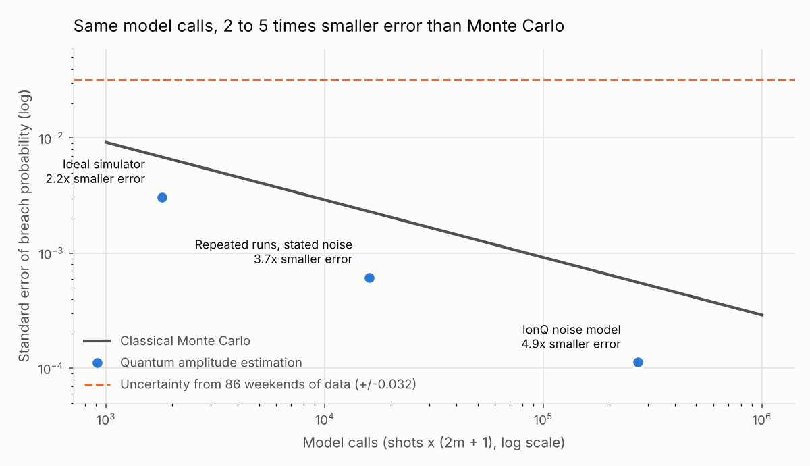

# How much liquidity should a bank prefund for the weekend?

Quantum amplitude estimation on Brazil's Pix data, built for the Qollab × IonQ Global Quantum Hackathon, 9 to 11 October 2026 (theme: Quantum Impact).

**Finding.** Using the Central Bank of Brazil's settlement-account balances, 9.3% of weekends since January 2025 drained more than 10% of the liquidity Pix participants prefunded on Friday. On IonQ's Forte Enterprise 1 noise model, amplitude estimation recovers that probability (0.0930) with 4.9 times smaller error than classical Monte Carlo at the same number of model calls. Five seeded repeated runs give a reproducible 3.7 times advantage. The advantage survives coherent rotation error up to 0.16° per Grover step.

Full write-up, live runs and charts: https://qollab.xyz/u/teamlh44/how-much-liquidity-should-a-ba

## Run it
The project runs on [Qollab](https://qollab.xyz) in the browser. Press Run with the Built-in simulator selected: the default stage (`STAGE = "judge"` in `main.py`) prints the data, a live circuit at four depths, the repeated-runs study, the saved IonQ results with the rotation threshold, and the classical baseline in about 30 seconds.

To reproduce the IonQ runs: set `STAGE = "circuit"` and `M` to the depth, choose IonQ Forte Enterprise 1 (29q) simulator, 2,000 shots. Every saved run is in `results.py` with its backend, shots and time.

## Files
| File | What it does |
|---|---|
| `main.py` | Entry point; `STAGE` picks what runs |
| `data.py` | Loads the BCB balances, builds 86 weekend drawdowns and four probability bins |
| `circuits.py` | 2-qubit state preparation, Grover steps (3 two-qubit gates each), calibration circuits |
| `estimate.py` | Maximum-likelihood amplitude estimation with signal-loss and readout terms |
| `noise_study.py` | Five seeded runs with a stated noise model |
| `baseline.py` | Classical Monte Carlo error and data uncertainty |
| `rotation.py` | Fitted rotation error and the 0.16° threshold |
| `charts.py` | The four figures |
| `results.py` | Every saved RESULT line |
| `Pix*.csv` | Banco Central do Brasil, Estatísticas do SPI, ODbL, retrieved 9 October 2026 |

## Disclosure
All code, circuits, analysis and text were written during the build window, 9 to 11 October 2026; the approach was rehearsed beforehand on a synthetic distribution, and no code or results from that rehearsal are used. AI tools (Claude) assisted with drafting code and text; all design decisions, runs and interpretations are the author's. Method: Suzuki et al. (2020), Giurgica-Tiron et al. (2022).

## Licence
MIT. Data: Banco Central do Brasil, Open Database Licence.

This effort is supported by Qollab & IonQ.
